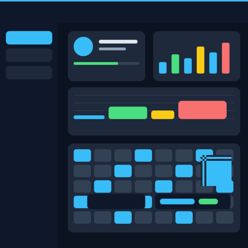

# Tessera

> Working name — easy to rename.

A high-performance, cross-platform C++ UI framework:
JSX/React syntax as the design DSL, compiled to native C++,
**Vulkan** as the main rendering backend, **WebGPU (Wasm)** for
zero-emulator design-time preview, and deterministic headless
rendering for AI-agent visual regression.

Status: **pre-alpha / Big Step B1 complete** (RHI, Vulkan batched 2D, scene graph).

## Documents

Start with the [documentation map](docs/README.md) and [architecture overview](docs/architecture/overview.md).

- [Architecture overview](docs/architecture/overview.md)
- [Module map](docs/architecture/module-map.md)
- [Getting started](docs/guides/getting-started.md)
- [Design plan v1](../ui_framework_design_plan_v1.md)
- [Execution plan & workload breakdown](../ui_framework_execution_plan.md)
- Architecture decisions: [`decisions/`](decisions/) — index at
  [`decisions/README.md`](decisions/README.md)
- [Project generator & developer config](docs/guides/project-generator.md)
- [Developer workflow & protected regions](docs/guides/developer-workflow.md)
- [`tessera.json` schema v1](docs/specs/project-config-v1.md)
- [Code style & build cache](docs/guides/code-style.md)
- [Dependency map](docs/specs/dependencies.md)
- [Renderer / RHI design](docs/design/renderer.md)
- [Scene graph & events](docs/design/scene-graph.md)
- [UI model](docs/design/ui-model.md)
- [Layout / text / animation](docs/design/layout.md), [text](docs/design/text.md),
  [animation](docs/design/animation.md)
- [Responsive / accessibility](docs/design/responsive.md), [accessibility](docs/design/accessibility.md)
- [Stylesheet engine spec](docs/specs/stylesheet-v1.md)
- [Compiler / IR / component model](docs/design/compiler.md), [IR spec](docs/specs/ir-v1.md),
  [component model](docs/specs/component-model-v1.md)
- [UI virtualization](docs/specs/virtualization-v1.md)
- [Design-time viewer](docs/design/designer.md)
- [Runtime config spec](docs/specs/runtime-config-v1.md)
- [Runtime loop & frame pacing](docs/design/game-loop.md)
- [Dirty rendering & invalidation](docs/design/dirty-rendering.md)
- [Performance & power](docs/design/performance.md)
- [Window resize & lifecycle](docs/design/window-resize.md)
- [HAL](docs/design/hal.md), [OS events & foldables](docs/specs/os-events-v1.md)
- [Mobile integration](docs/design/mobile-integration.md)
- [Async runtime](docs/design/async.md)
- [Threading & memory](docs/design/threading-and-memory.md)
- [Resources](docs/design/resources.md), [services](docs/design/services.md),
  [security](docs/design/security.md)
- [Diagnostics & profiling](docs/design/diagnostics.md)
- [Diagnostics config](docs/specs/diagnostics-config-v1.md)
- [Input handler](docs/design/input.md)
- [Testing](docs/guides/testing.md), [golden tests](docs/specs/golden-tests-v1.md)
- [Packaging](docs/guides/packaging.md), [build & packaging design](docs/design/build-and-packaging.md)
- [Debugging](docs/guides/debugging.md), [glossary](docs/reference/glossary.md)
- [Batched2D reference image](docs/images/batched2d.png)
- Design / specs / guides: [`docs/`](docs/)

## Repository layout

```text
Tessera/
├── docs/                 design notes, specs, RFCs, guides, research
├── decisions/            ADRs (ADR-001 ...)
├── include/tessera/      public headers
├── src/
│   ├── core/             object, memory, threading, event, resource
│   ├── hal/              window, display, input, graphics, audio,
│   │                     filesystem, power, timer, lifecycle
│   ├── ui/               view, scene, layout, style, animation, responsive,
│   │                     text, accessibility
│   ├── rendering/        rhi, gpu, scenegraph, scheduler, resources, null,
│   │                     backend/{vulkan,webgpu}, software
│   ├── services/         i18n, navigation, notification, storage, networking
│   ├── diagnostics/      logging, profiling, crash
│   ├── compiler/         analyzer, rules, ir, codegen, merger
│   ├── platform/         windows, linux, macos, android
│   └── runtime/          C++ support runtime for generated code
├── designer/             web (Wasm viewer) + native (IPC host)
├── tests/                unit, integration, golden, fixtures, benchmarks
├── samples/              hello, dashboard
├── tools/                shaders, font, build tooling
├── third_party/          vendored dependencies
├── cmake/                CMake helpers
├── scripts/              dev / CI scripts
└── .github/              CI workflows, issue templates
```

## Build

Requirements: CMake >= 3.24, a C++20 compiler, and the Vulkan SDK
(`VULKAN_SDK` set; `glslc` in the SDK `Bin/` or on `PATH`).

Windows (MSVC 2022/2026):

```powershell
cmake --preset vs2026
cmake --build --preset vs2026-release
ctest --preset vs2026-release
.\build\vs2026\tools\poc\vulkan_offscreen\Release\vulkan_offscreen_poc.exe --out offscreen.png
.\build\vs2026\tools\poc\batched2d\Release\batched2d_poc.exe --backend vulkan --out batched2d.png
```

Manual fallback: `cmake -S . -B build -G "Visual Studio 18 2026" -A x64` (or
`"Visual Studio 17 2022"`), then build/ctest as before.

Linux (headless, Mesa lavapipe):

```bash
cmake --preset dev
cmake --build --preset dev
ctest --preset dev
VK_ICD_FILENAMES=/usr/share/vulkan/icd.d/lvp_icd.x86_64.json \
  ./build/dev/tools/poc/vulkan_offscreen/vulkan_offscreen_poc --out offscreen.png
VK_ICD_FILENAMES=/usr/share/vulkan/icd.d/lvp_icd.x86_64.json \
  ./build/dev/tools/poc/batched2d/batched2d_poc --backend vulkan --out batched2d.png
```

Tools and demos:

- `vulkan_offscreen_poc` — Vulkan 1.3 dynamic rendering into an offscreen image, read back to
  host memory, written as a PNG (no window, no swapchain).
- `batched2d_poc` — RHI + batched 2D: solid/SDF/textured quads, clip and transform stacks,
  PNG + raw RGBA output. `--backend null` runs without a GPU.
- `merger_poc` — injects developer protected regions into freshly generated C++.

## Tooling

- `.clang-format`, `.clang-tidy`, `.editorconfig`
- `CMakePresets.json`: `dev`, `release`, `ci`, `vs2026`, `vs2022`
- `scripts/format.ps1` / `scripts/format.sh` (with `--check`)
- `scripts/lint.ps1` / `scripts/lint.sh`
- Compiler cache: `TESSERA_USE_COMPILER_CACHE=ON` (prefers `sccache`, supports `ccache`)
- Linux: `cmake --preset dev && cmake --build --preset dev && ctest --preset dev`
- Windows: `cmake --preset vs2026 && cmake --build --preset vs2026-release`

## Renderer status (Big Step B1)



- Thin RHI + null backend + Vulkan 1.3 backend using **volk** and **VMA**.
- Batched 2D: solid quads, SDF rounded rects, textured quads, scissor clip stack, affine
  transform stack.
- Scene graph with hit testing and W3C-style capture/target/bubble events.
- Offscreen demo writes a deterministic PNG and raw RGBA; CI runs a Vulkan smoke test.
- B2 runtime design: full-CSS stylesheet engine, input handler, fixed-step loop, dirty
  rendering, FPS cap/vsync/VRR, frame pacing.
- Defaults are **power-aware**: static UI idles (no presents/GPU work), no busy-wait, no
  full-GPU target; continuous/benchmark modes are explicit.
- B2/B3 design: async/await runtime (no UI blocking), resize/DPI/lifecycle with OS compliance,
  normalized OS events across desktop/mobile/foldables, structured diagnostics/tracing/profiling.
- B2 next: implement the runtime slice, then Yoga/text/glyph atlas and pixel goldens.

## Next

1. ADR-001 … ADR-023 in `decisions/`.
2. Big Step B2: stylesheet engine, input, fixed-step loop, dirty rendering, frame pacing,
   async runtime, diagnostics, Yoga/text, pixel goldens.
3. Big Step B3: window/swapchain, resize/DPI/lifecycle, OS events, mobile/foldables.
4. Big Step C: JSX → IR → C++ vertical slice with protected regions.

## License

MIT. See [LICENSE](LICENSE).

Third-party components and their licenses are listed in
[THIRD_PARTY_NOTICES.md](THIRD_PARTY_NOTICES.md). The canonical dependency map is
[docs/specs/dependencies.md](docs/specs/dependencies.md).
