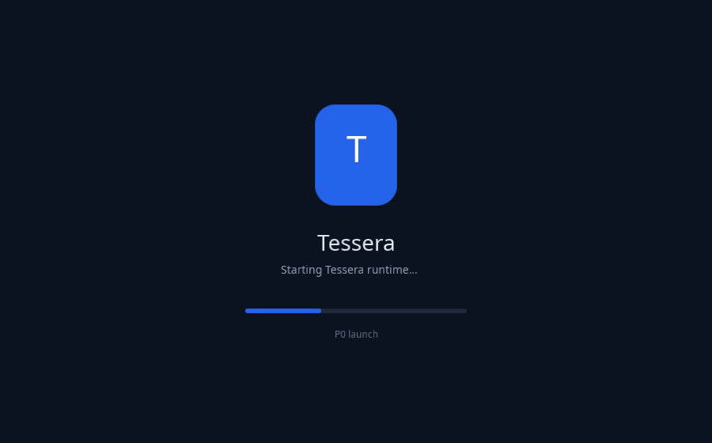
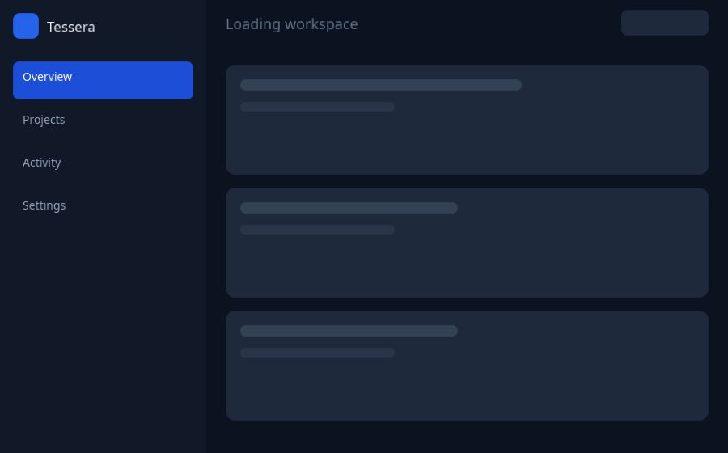
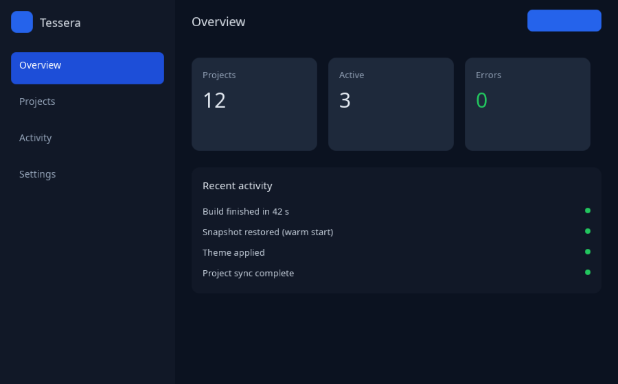
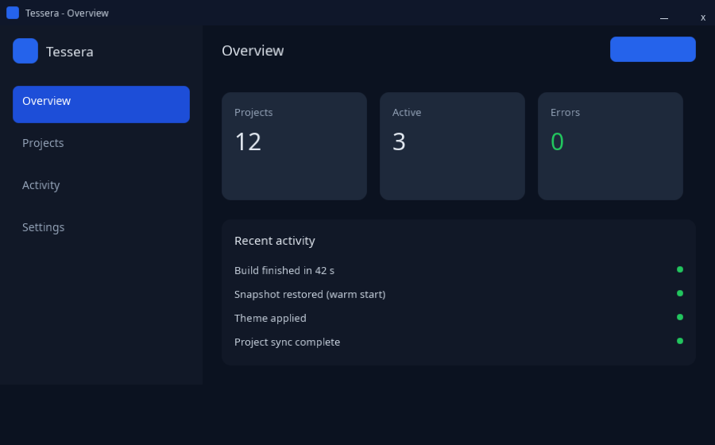
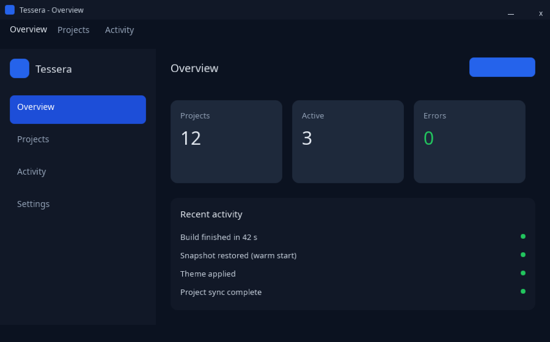

# Shell design preview (mock captures)

Status: design preview. The five images below are rendered by
[`tools/poc/design_mock`](../../tools/poc/design_mock/main.cpp) through the **real** engine path
(`AppHost` style → Yoga layout → Batched2D paint → offscreen readback); only the *content and states*
are mocked. The startup phase scheduler, the Windows custom title bar and the framework `AppBar`
component are **not implemented**: their normative contracts are the startup API and window-chrome
specs (in review, PR #34).

Rendered at 900×560, 2026-11-11.

## 1. Startup phases

The startup API splits the launch into P0 `launch` → P1 `runtime` → P2 `first_frame` →
P3 `background_init` → P4 `interactive` → P5 `optimizing`. P0 and P2 are the frames a user can
see before the app is interactive; P4 is the app shell after data arrives.



**P0 launch.** The platform/OS window before the runtime has a first frame: brand mark, product
name, "starting" caption and a static progress stub. In the spec this frame belongs to the platform
launch story (or a `loading.brand` splash); the framework default is the generic loading screen.



**P2 first frame.** Theme, shell chrome and layout are up, but route data is still loading: the
sidebar/top bar are real, the content area is skeleton placeholders. This is the frame at which the
first paint budget is measured.



**P4 interactive.** The same shell after data and background work settled. The mock shows summary
cards and a short activity list; the transition from P2 to P4 is the progressive-disclosure budget
(`first_contentful` → `interactive`).

## 2. Window chrome

The chrome spec has four layers: system chrome (OS), framework chrome (engine-drawn title bar and
`AppBar`), app chrome (toolbars, bottom navigation) and content. The two mocks show the same app
content under the two title-bar options.



**System title bar.** The default on every platform in V1: the OS owns the title bar and window
controls; the framework starts below it.



**Framework title bar (Windows V1 opt-in).** The engine draws a 32 logical-px title bar (app icon,
title, minimise/maximise/close hit-test targets) and the framework `AppBar` row below it. The
Windows implementation needs `WM_NCCALCSIZE`/`WM_NCHITTEST`, DWM frame handling, per-monitor DPI and
accessible window controls; only this mock exists today.

## 3. Regenerating

```sh
cmake --preset dev
cmake --build --preset dev --target design_mock
./build/dev/tools/poc/design_mock/design_mock <output-dir>
```

The `design_mock` CTest entry runs the same tool into the build tree (and skips when no Vulkan
device is available). The tool writes `startup-p0.png`, `startup-p2.png`, `startup-p4.png`,
`chrome-system.png` and `chrome-custom.png`.

### Reviewing the real app: `gallery --inspect`

The images above are a *mock* of the shell. The shipping app is the library gallery
(`samples/gallery`, `Gallery.tsx` → codegen → native), and it has 23 committed lavapipe goldens
under `tests/golden/gallery/`. Those goldens are deliberately gated to lavapipe
(`harness::capture_capability`), because only one rasterizer can back a byte-comparable baseline —
so on a machine with a hardware GPU every `gallery_golden_*` test **skips**, and a developer never
sees what the app looks like while changing it.

```sh
gallery --inspect render-out/gallery
```

renders the same 23 cases through the ungated capture path on whatever Vulkan device is installed,
writes one PNG per case and an `index.html` contact sheet. The cases mirror the CTest matrix in
`samples/gallery/CMakeLists.txt`, so a reviewed image maps to a named golden. These are inspection
images, not the goldens: they are not byte-comparable with `tests/golden/gallery/`, and CI remains
the authority. Keep the two lists in sync when a case is added (`samples/gallery/inspect.cpp` and
the `_gallery_cases` block).

## 4. What the mock proves, and what it does not

- Proves: the shell compositions are expressible with the current scene/style/layout/paint
  surface — inline styles for geometry, rounded rects and borders, real text shaping, and the
  offscreen capture path used by CI.
- Does not prove: phase scheduling, launch-screen ownership, state restoration, the framework
  chrome components, window-control hit testing, or accessibility of the title bar. Those are
  specified in the startup/chrome specs and tracked in their implementation slices.

Related: [app-host.md](app-host.md), [startup-and-loading.md](startup-and-loading.md),
[designer.md](designer.md), [component-library.md](component-library.md).
