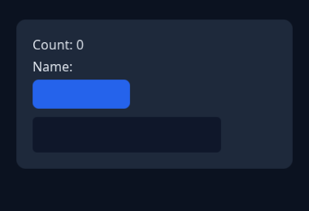
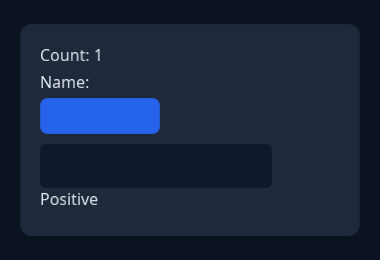

# click-demo

The interactive acceptance for the app-host lane: the generated `Demo` component
(`samples/compiler-demo/Demo.tsx` → IR → C++), styled by a real compiled stylesheet, laid out by
Yoga, painted through the Batched2D Vulkan backend, driven by `tessera_app::AppHost`.




The second image is the same scene after a real pointer click on the generated `Button`: the
generated handler increments `count`, the interpolated `Count: 1` text repaints and the conditional
`Positive` child attaches with a Yoga reflow. The click goes through `ui::InputRouter` (pointer
down/up → click synthesis), the same path the window's `InputPump` uses.

## Run

```sh
# Offscreen capture (no window; any Vulkan device, including lavapipe in CI)
click_demo --capture before.png
click_demo --click --capture after.png

# Visible window, real mouse input
click_demo --windowed

# CI smoke: hidden window, five presented frames
click_demo --windowed --hidden --frames 5
```

`--font path.ttf` overrides the bundled test font, `--width`/`--height` the client size. The
`click_demo_capture` CTest entry runs the capture mode and skips when no Vulkan device exists.

## What it proves

- `AppHost` runs the `docs/design/app-host.md` order (style → layout → sync → damage → paint) and
  the scene idles after settling (the windowed loop only wakes for input, resize or a forced smoke
  frame).
- The runner is the public `tessera_app_window` library: `WindowHost` owns the window, swapchain,
  renderer and font stack, and `capture_frame` renders one offscreen frame through the same path.
- A compiled stylesheet styles generated nodes by element type (`View`, `Text`, `Button`,
  `TextInput`), including radius/border/padding.
- The generated component's `setState` path repaints only the damaged region; the present loop
  still redraws the whole swapchain image because swapchain images are not preserved.

## Limitations (deliberate, current slices)

- Buttons have no label glyph: the compiler does not emit text content for `Button` yet, and the
  sample's stylesheet draws only the button box.
- The window's damage-clipped path is not used for presentation yet: a frame that happens is
  painted in full (the damage plan decides *whether* to paint), matching the batched2d POC.
- `:hover` and `:active` are styled and driven by `InputPump` → `InputRouter`; the cursor *shape*
  is not set (the HAL has no cursor-shape API yet), and `TextInput` focus/IME in the window path
  arrives with the input slice.
